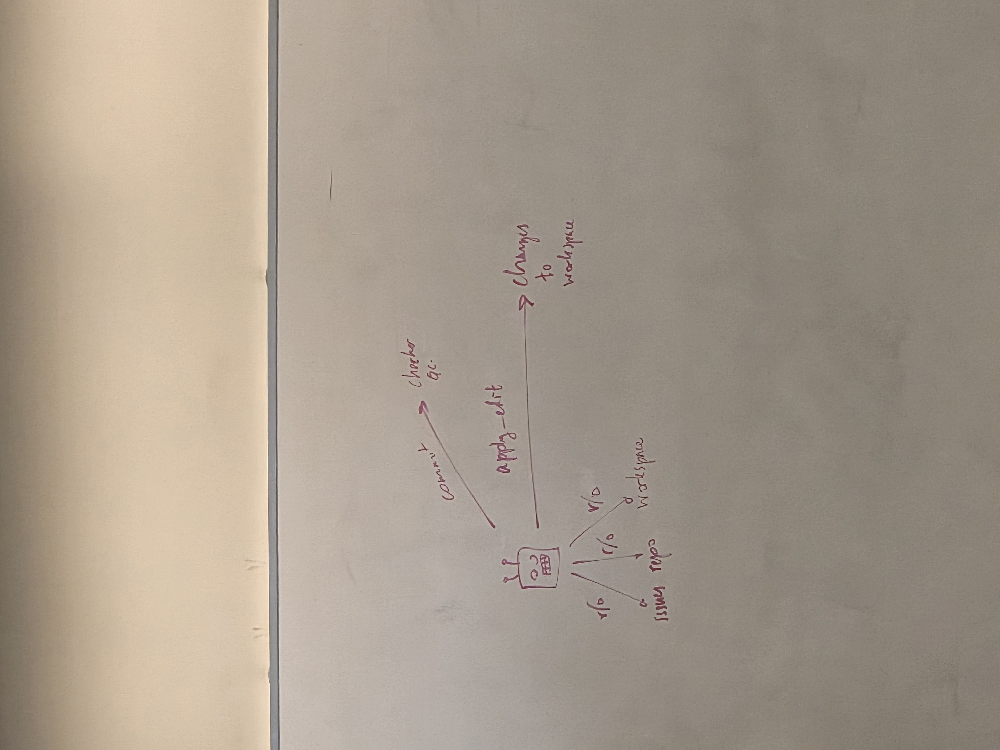
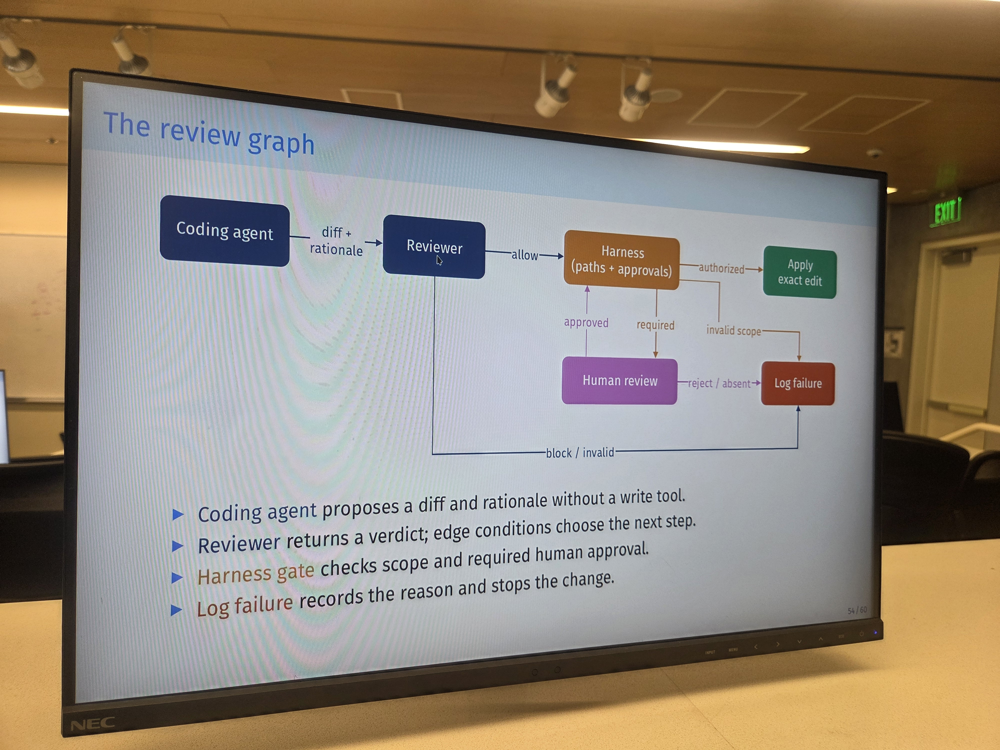

# Week 6: Gating Agent Actions

## Lecture: Oct 1

**Note taker: Het Patel**



The agent initially has **read-only access** to:

- Issues
- Repository
- Workspace

If you are running this on a public repository, that is a horrible idea.

**Why?** Someone could create a malicious issue and exploit the agent through prompt injection.

### How to prevent this

Place a **gate** between the agent's proposed action and the actual edit or effect. For instance, require human approval before harmful or sensitive actions can take place.

Agents can also cheat on benchmarks if they learn to game the verifier (for example, SWE-bench).

## Agent in Charge vs. a Gate

### Deterministic rules

Example: If the sender and recipient are from the same country, accept; otherwise, reject.

### Agent in charge

The coding agent decides which action to take.

Deterministic rules are generally more predictable and trustworthy for the conditions they explicitly check, but they are limited in scope compared with an agent making contextual decisions.

## Intercepting Tool Calls

A policy check can intercept a proposed tool call before it executes:

```text
Proposed tool call → Policy check → Pass or block
```

**Hooks** can be used to intercept tool calls.

### Two policy checks

1. **Edit scope:** Codex should not access or edit files outside its permitted project scope.
2. **Human approval:** Deletion is not allowed until a human approves it.

## Deterministic Gate

**Strengths**

- No extra LLM call, so it is cheap.
- Decisions are testable.

**Limitations**

- Usually cannot establish correctness.
- Can miss nuanced violations.

## Using an LLM as the Gate

Instead of relying only on deterministic rules, an LLM can review the proposed action before an edit is applied.

Other options include trained classifiers, such as BERT-based models, or specialized models such as GPT-OSS 20B.

### Review agent

A review agent can return an **allow** or **block** verdict.

Give the reviewer a policy covering:

- **Task fit:** Is the proposed change relevant to the task?
- **Preserve safeguards:** Does the change maintain existing safety checks?
- **Reject injected instructions:** Does it ignore malicious instructions in untrusted content?
- **Respect human authority:** Does it require human approval when appropriate?

### Reading the verdict

The code shown in class used `verdict.lower()` to normalize the response in case the agent did not follow the requested capitalization.

## The Review Graph



1. The **coding agent** proposes a diff and rationale without direct access to a write tool.
2. The **reviewer** returns a verdict; the result determines the next step.
3. The **harness gate** checks edit scope and whether human approval is required.
4. If authorized, the system **applies the exact edit**.
5. If blocked, invalid, rejected, or missing approval, the system **logs the failure** and stops the change.

## Classifier / LLM Gate

**Strengths**

- Can compare old and new behavior.
- Can challenge an unrelated edit.

**Limitations**

- Can follow injected prompts.
- Is stochastic in nature.
