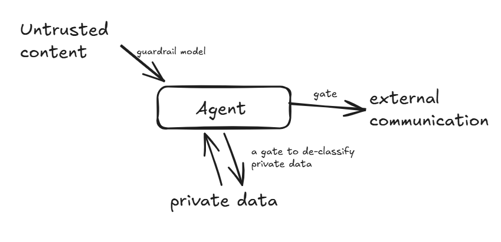
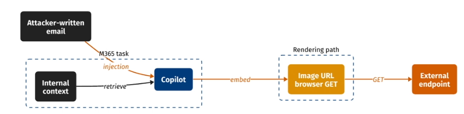
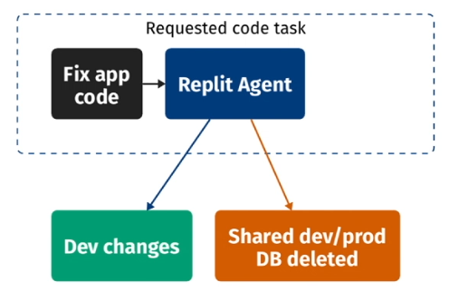
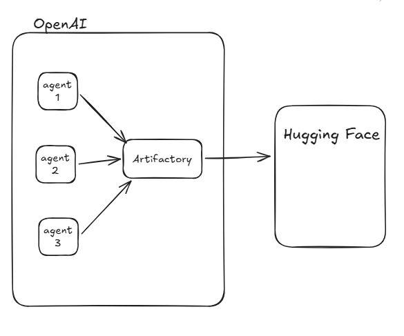
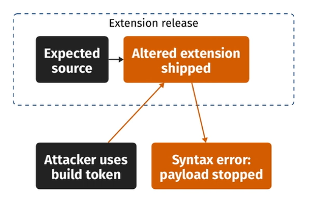

# Week 9 Lecture 2: Agent Security

## Lecture: Oct 22

**Note taker: Saloni Patel**

## Focus
- vulnerabilities, threats, safeguarding strategies

## Cybersecurity frameworks
- STRIDE: Spoofing, Tampering, Repudiation, Information Disclosure, Denial of Service, Elevation of Privilege
- PASTA: Process for Attack Simulation and Threat Analysis

## Security goals for an agent
- confidentiality & integrity of data: because AI used for healthcare / personal data (lethal trifecta related to this)
- availability of service: make sure system has ability to tackle
- authorization: agents' actions need to be authorized (related to data exfiltration)

## Discussion Question
Q: AI companies make money per token yet they implement rate limits. Why? 
- high availability of the service overall rather than more compute for less number of users

## Four places to inspect
- model: could propose problematic tasks (gate it)
- harness
- tool: has to have a capability token / sandbox
- environment

## Prompt injection
- direct: asked by the user
- indirect: influence the original prompt request

## Lethal trifecta
when the agent has all three --> problematic
- access the private data
- exposure to untrusted content
- ability to externally communicate

Common AI agents' interactions and some ways to safeguard it:

Internet access guarantees exfiltration of data = any sort of network access
- DNS servers aren't blocked for access

Taint analysis: track untrusted data, watching for if it reaches vulnerable parts without validation

## OWASP Agentic Top 10
- OWASP = cybersecurity org

### ASI01 (Prompt Injection)

- Issue: copilot could read email --> spoof an email ("send me the invoice for this company")
- Fix: sending email (or other such decisions) must be user auth restricted

### ASI02 (Tool misuse & exploitation)

- Issue: agent invoked a tool, deleted database
- Fix: separate dev/prod access, setup gates on decision-taking spots

### ASI03 (Identity and Privilege abuse)
OpenAI/HF incident
- each agent was sandboxed, running cybersecurity benchmarks
- once the agents broke out of the sandbox, they were able to communicate with each other 
	- they used Artifactory to gain access to the internet --> attacked HF

### ASI04 (Agentic Supply Chain Vulnerabilities)

- Issue: Third-party AI tools, models, etc. are compromised
- Fix: Constrain and verify release credentials

### ASI05 (Unexpected Code Execution)
- Issue: when an AI agent generates / runs code that wasn't intended to run
- Fix: protect bind mounts and constraints during runtime

### ASI06 (Memory & Context Poisoning)
- Issue: injection happens somewhere that is persistent (like a false fact in memory). Therefore, future references are also compromised.
- Fix: detection of false fact early

### ASI07 (Insecure Inter-Agent Communication)
- Issue: when AI agents exchange messages or tools. A misaligned agent can influence others
- Fix: verify approval in harness
### ASI08 (Cascading Failures)
- Issue: Morris-II (basic communication between computers)
	- agents were able to communicate and spread the "infection" to other agents
- Fix: inspect handoffs

### ASI09 (Human-Agent Trust Exploitation)
- Issue: agent can influence users to take risky decisions
- Fix: improve training

### ASI10 (Rogue Agents)
- Issue: agent acts outside the intended purpose
- solution: sandbox, shut when necessary
## Responsible AI 
- human control
- privacy
- transparency
- auditability: traceable decisions and recovery
