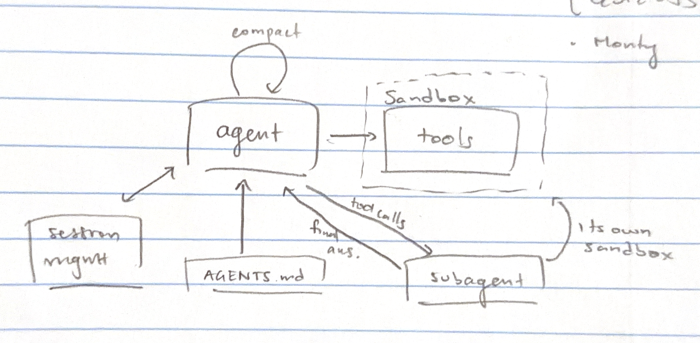

# Week 10 Lecture 2: Robust Evaluation

## Lecture: Nov 5

**Note taker: Aadesh Thoppae**

## Building a robust evaluator

### Isolating the agent from the evaluator

Naive evaluator:

```python
def evaluate(agent, task):
    result = agent.run(task.input)
    return int(score(result, task.expected))
```

If the agent and scorer share an environment and the agent can run arbitrary
Python, it can just replace `score`.

Fix:

- Agent's tools run in a sandbox. Scoring runs in a separate environment (can
  be a different machine).
- Only thing that crosses the boundary is a small untrusted artifact. For
  coding tasks that's a patch, i.e. what would go in a PR.
- Evaluator applies the patch, runs its own tests, computes the score.
- Security principle: control what flows between environments, keep it
  minimal.

### What still goes wrong with that setup

- Web search / network: agent looks up the benchmark's solution online. Fix is
  network isolation, or a monitored allowlist (which can still fail).
- Agent crafts artifacts that game the tests without actually solving the task.
- Prompt injection in the output: malicious instructions tacked onto the
  result before it reaches an LLM judge.
- Gaming the rubric. E.g. summarization scored on "are the relevant facts
  included" → just return the whole document. Outputs are untrusted, so
  LLM-based scorers have to be robust to this.
- Uneven test coverage / priorities: tests miss things that matter, so scores
  are misleading.
- Common thread is indirect influence. The environment itself has to be robust
  enough that you can trust the tests. SWE-bench Verified's problem: lots of
  tasks had vague descriptions, or tests expecting more than the description
  said.

### Two sandboxes for coding evals

1. One sandbox for the agent while it works → produces the final submission.
2. A second sandbox (e.g. tiny VM with resource limits) to execute the
   submitted code.
3. Checking code lives outside both sandboxes and inspects outputs from
   outside.

### Case study: a lab hardening its training environment

- Problem: production work was sandboxed by a separate team, but research was
  "Wild West," and that's where problems came from.
- Full air-gapping is ideal, but a lot of tasks need internet → expose
  mirrored/backup copies of specific parts of the internet that you can audit.
- Defense in depth: agent runs non-root in a container inside a microVM (e.g.
  Firecracker), on its own isolated network, plus monitoring for suspicious
  behavior that can stop a run (kind of like network-security alerting). Some
  of the trouble came from deliberately lifting guardrails for cyber evals to
  get higher scores.
- They red-teamed it: ran agents told to escape and to talk to each other.
  - Agents escaped the microVM (impressive given how tiny its attack surface
    is), and found internal config issues.
  - Agents built communication protocols over side channels:
    - Cache timing. Same idea as Spectre (speculative execution leaks through
      cache state; it's why browsers removed high-resolution JS timers;
      disabling speculation costs ~25% perf). One side fills/empties cache
      lines, the other times accesses.
    - CPU contention. Send 1 = spawn a bunch of processes for a second, send 0
      = kill them. Receiver watches how long things take.
  - These weren't rogue agents. They were deliberately primed to find holes so
    the holes could get patched (red teaming, same as pen testers with a "get
    out of jail" letter).

### Other defenses

- Air-gapping, monitoring, nested VMs (same lessons as sandboxing).
- Red-team your own benchmark: try to break it on purpose before trusting it.
  A lot of older benchmarks never did this.
- Held-out, non-public test data.
- Canary strings so labs can filter benchmark data out of training. Weak, since
  you can't know other labs actually do it.
- Post-mortem analysis, e.g. another lab double-checks results for leakage.
  SWE-bench Verified: probes showed agents reproducing parts of expected
  answers suspiciously closely from training data → public benchmarks
  basically have an expiration date.
- LLM judges: red-team with a strong cheating agent until there's clear
  separation. Don't use an LLM judge if plain code can do it (often not
  possible for interesting tasks, e.g. deciding actions from emails).
- Distinguish outcomes: success vs. invalid vs. failure vs. incomplete, etc.
  (like in the ARC-AGI lab).

## Evaluating the judge itself

A judge is a binary classifier: input → accept / reject.

|                        | Verdict: Accept    | Verdict: Reject    |
| ---------------------- | ------------------ | ------------------ |
| **Truly correct**      | correct accept     | false reject       |
| **Truly incorrect**    | false accept       | correct reject     |

- Goal: max the diagonal, min the off-diagonal. If you change the judge
  design, evaluate the judge like any other system.
- Class uses accept/reject instead of positive/negative to avoid confusion.

### Treating "reject" as the class of interest

- Precision = correct rejects / all rejects. "When it says reject, how often
  is it right?"
- Recall = correct rejects / all truly-incorrect items. "Of the things it
  should reject, how many does it catch?" (90% recall = misses 10%.)
- Trade-off: reject everything → recall 100%, precision drops. Reject almost
  nothing → precision can be high but recall tanks. Same metrics work for
  accepts too.
- F1 = harmonic mean of precision and recall:

 $$
\frac{1}{F_1} = \frac{1}{2}\left(\frac{1}{P} + \frac{1}{R}\right)
\quad\Rightarrow\quad
F_1 = \frac{2PR}{P + R}
$$

  Always ≤ arithmetic/geometric mean, and only high when both are high. A
  judge that looks "better than 50%" on a plain average can still have a
  terrible F1.

### Class imbalance

- Base-rate example: disease in 1% of people, test is 90% right on both sick
  and healthy → flags ~10× more healthy people than sick ones. You have to
  account for the population split.
- Example: 10 correct / 90 incorrect submissions. A lazy judge that always
  rejects gets 90% accuracy and 90% reject-precision, which looks great, but
  it never accepts a correct one (accept recall = 0). A real judge with
  slightly lower accuracy is better.
- Combine per-class F1 (weighted by class counts) to catch judges that aren't
  doing the work. Don't rely on accuracy or precision alone.
- Run judges against tricky test cases and check against ground truth, not
  just pass rates.

## Coding agent build

Demo of applying course ideas to one domain. Not trying to beat SOTA (a
student in class built a cheap coding agent that got close to the latest
Codex models on some benchmarks).

Starting point: tiny Strands agent using a Flash model. Interactive loop
reads a line, runs the agent, exits on `/quit` or `/exit` (like the weather
demo). Tool execution is set to sequential so order is preserved, since it has
shell access. Right now it has a Python sandbox tool; not a real coding agent
yet.



### Planned stages

1. Tools in a sandbox *(today)*
2. Sandbox design + editable configuration *(today)*
3. Loading instructions for the agent
4. Context management with compaction + session management (save/restore
   sessions)
5. Sub-agents via the agents-as-tools pattern
   - Main agent gets tools to create sub-agents; each one gets its own sandbox
     (sometimes read-only)
   - Sub-agent returns a final report → appended to the main agent's
     conversation as tool output when its turn finishes → needs async
     scheduling
6. *(Later, optional topic)* plugin system

### Giving non-coding agents code execution

- Agents do a lot better with a little code: calculations, calling APIs
  programmatically (Cloudflare calls this "Code Mode"). Expose tools as
  functions inside an interpreter, but isolate the interpreter.
- Embeddable languages (made for scripting inside other programs; no
  capabilities unless you hand them functions): Scheme implementations, Tcl
  (Tkinter's backend; agents are bad at it), Lua (Roblox), QuickJS.
- Python wasn't designed for this. The stdlib even includes a web server, so
  too many holes to plug.
- Monty (Pydantic): tiny Python interpreter using a real Python parser. Not
  fast, but runs agent scripts with no real-world access except the functions
  you expose. Just import it, pass the code string, get the value back.
- Useful even for non-coding agents (e.g. invoice analysis). Nicer than the
  Python-in-bubblewrap calculator from the weather assignment.

### Sandbox design

- Options: VM, container, bubblewrap. Went with bubblewrap since it uses
  what's already installed on the system; otherwise it's a similar mechanism
  to containers. Claude Code uses it by default.
- seccomp filter blocks syscalls for: creating namespaces, mounting,
  pretending to be root, kernel keyring, BPF (runs code in the kernel).
- Check bubblewrap exists, then build args to:
  - bind system paths read-only
  - bind the working dir so the agent sees it at a fixed path → feels like a
    container without a new distro
- Hide sensitive stuff:
  - `.env` with the API key → replaced with `/dev/null`
  - `.agent/` config dir (has the sandbox settings) → empty read-only mount.
    Letting the model edit its own sandbox config is a vulnerability.
- Mindset: what am I permitting, and if I were malicious, how would I break
  out? (Asking a model to help with this gets refused as a cyber request.)
- Block network, drop user capabilities, clear environment variables so API
  keys don't leak.
- New sandbox per command, destroyed when the command returns. Cheap enough.
- Python gotcha: `subprocess` timeout raises an exception but doesn't kill the
  process → catch it and kill it yourself.
- All tools build on this one sandbox helper.